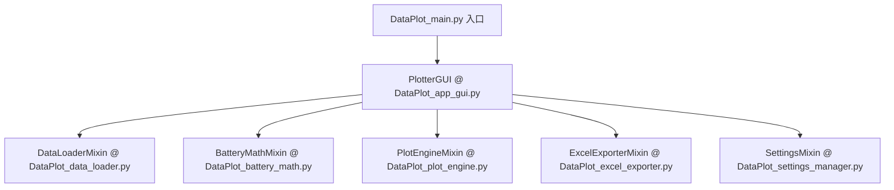

# DataPlot 项目工程指南与上下文备忘录 (AGENTS.md)

> **说明**：本文件为 Antigravity 智能助手的核心上下文规范。每次打开项目启动对话时，本文件都会被自动加载，记录了本项目的架构设计、编码规范、版本管理及历史修改记录。

---

## 1. 项目概览

- **项目名称**：DataPlot
- **定位**：面向海量测试数据（FLOEFD 热流仿真、电池充放电曲线等）的高性能多轴可视化与格式转换桌面软件。
- **技术栈**：Python 3.12 + PySide6 (Qt) + Matplotlib + Pandas + OpenPyXL + Inno Setup

---

## 2. 模块架构 (Mixin 组合设计)

主窗口类 `PlotterGUI` 位于 [DataPlot_app_gui.py](file:///e:/Antigravity/DataPlot/DataPlot_QT/DataPlot_app_gui.py)，通过多重继承组合了以下 Mixin 模块：



| 模块文件 | 职责说明 | 关键方法 / 属性 |
| :--- | :--- | :--- |
| [DataPlot_main.py](file:///e:/Antigravity/DataPlot/DataPlot_QT/DataPlot_main.py) | 程序启动入口，控制台编码配置，DPI 兼容性设置，OpenPyXL 日期补丁 | `main()`, `resource_path()` |
| [DataPlot_app_gui.py](file:///e:/Antigravity/DataPlot/DataPlot_QT/DataPlot_app_gui.py) | 界面构建主控制器，组件组装，状态绑定，窗口生命周期与布局维护 | `PlotterGUI`, `Var`, `bind_lineedit()` |
| [DataPlot_plot_engine.py](file:///e:/Antigravity/DataPlot/DataPlot_QT/DataPlot_plot_engine.py) | 绘图引擎核心，负责多 Y 轴双/三轴图、电池循环对比、dQ/dV 图、图例与坐标刷新 | `update_plot()`, `plot_data()`, `_clear_legends()`, `_is_axis_title_visible()` |
| [DataPlot_data_loader.py](file:///e:/Antigravity/DataPlot/DataPlot_QT/DataPlot_data_loader.py) | 数据解析与加载，支持 Excel、CSV 快速清洗载入，大文件分块处理 | `load_file()`, `convert_csv_to_excel_fast()` |
| [DataPlot_battery_math.py](file:///e:/Antigravity/DataPlot/DataPlot_QT/DataPlot_battery_math.py) | 电池数据特征计算：工步时间/循环时间重构、dQ/dV 导数滤波平滑 | `calculate_time_diff_series()`, `compute_dqdv()` |
| [DataPlot_excel_exporter.py](file:///e:/Antigravity/DataPlot/DataPlot_QT/DataPlot_excel_exporter.py) | 绘图曲线干净数据导出为 Excel | `save_plot_data_to_excel()` |
| [DataPlot_settings_manager.py](file:///e:/Antigravity/DataPlot/DataPlot_QT/DataPlot_settings_manager.py) | 用户配置保存与恢复，对接 `settings.json` | `save_settings()`, `load_settings()` |

---

## 3. 关键编程规范与陷阱守则

### 3.1 `Var` 状态包装类与 UI 交互
- 项目使用自定义的轻量级 `Var` 类作为属性观察者（支持 `.get()`、`.set()` 和 `.trace_add('write', cb)`）。
- **避坑提示**：
  - `self.x_title` 是 `QLineEdit` 组件，其文本读取使用 `.text()`，而非 `Var.get()`。在读取时应使用安全兼容写法：
    ```python
    x_title_text = self.x_title.text() if hasattr(self.x_title, 'text') else self.x_title.get()
    ```
  - 坐标轴显隐状态读取请统一使用 `self._is_axis_title_visible(settings_list, axis_idx)`，不要直接在参数默认值中临时实例化 `Var`。

### 3.2 Matplotlib 图例清理机制
- 在多 Y 轴绘图时，图例会通过 `add_artist` 添加到主画布。直接调用 `ax.get_legend().remove()` 可能因为对象不在内置列表而触发 `ValueError: list.remove(x): x not in list`。
- **清理图例必须统一调用**：
  ```python
  self._clear_legends(self.fig.axes)
  ```

### 3.3 异步回调闭包与作用域安全
- 在 `except Exception as e:` 之后，若使用 `QTimer.singleShot(0, lambda: ...)`，**不可在 lambda 体内直接引用 `str(e)`**，因为 Python 会在退出 except 块时自动执行 `del e`。必须固化参数：
  ```python
  error_msg = f"操作失败: {str(e)}"
  QTimer.singleShot(0, lambda msg=error_msg: QMessageBox.critical(self, "错误", msg))
  ```

---

## 4. 版本管理与一键打包发布工作流

### 4.1 版本号同步定义
修改版本号时需保持以下位置一致（脚本已支持自动读取同步）：
1. [DataPlot_app_gui.py](file:///e:/Antigravity/DataPlot/DataPlot_QT/DataPlot_app_gui.py)：`self.setWindowTitle("DataPlot vX.Y.Z")` 与 `self.version = "X.Y.Z"`；
2. [setup.iss](file:///e:/Antigravity/DataPlot/DataPlot_QT/setup.iss)：`#define MyAppVersion "X.Y.Z"`。

### 4.2 本地打包测试
```powershell
python Build_DataPlot_Setup.py
```
- 会自动执行 `DataPlot_gui_exe.py`（PyInstaller 打包输出至 `dist/DataPlot/`）；
- 会自动定位 Inno Setup 编译器，编译生成 `installer_output/DataPlot_Setup.exe`。

### 4.3 一键发布至 GitHub Release
```powershell
python Publish_GitHub_Release.py -v vX.Y.Z -m "版本说明信息"
```
- 自动完成本地 Portable ZIP 压缩、Git Commit、Git Tag、Push main 与 Tag、调用 GitHub REST API 创建 Release 并上传 EXE 和 ZIP 附件。

---

## 5. 近期版本修改历史备忘

详细更新日志见 [CHANGELOG.md](file:///e:/Antigravity/DataPlot/DataPlot_QT/CHANGELOG.md)。

- **v1.1.1 (2026-10-09)**：
  - 修复 `DataPlot_plot_engine.py` 中 `Var` 未定义导致的绘图崩溃报错；
  - 修复非 general 模式下 `self.x_title.get()` 的 `AttributeError` 崩溃隐患；
  - 修复 Y 轴 Min/Max 为空时（自动缩放），点击“显示/隐藏”或修改标题未刷新界面的问题；
  - 引入 `_clear_legends` 解决 Matplotlib `list.remove` 内部异常；
  - 修复 CSV 异步转换回调闭包异常；
  - 发布 GitHub Release v1.1.1。
- **v1.1.0 (2026-09-30)**：
  - 坐标轴范围增加标题显示/隐藏切换开关；
  - 图例水平位置增加折叠面板与三轴滑动调节滑块，支持一键重置默认坐标；
  - 配置持久化升级。
