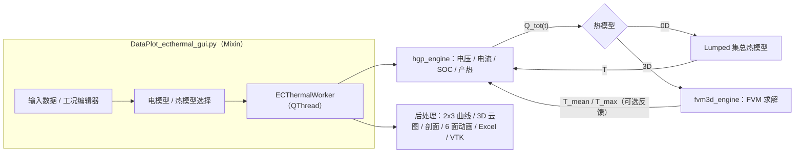

# DataPlot 集成方案：电芯电-热耦合仿真（HGP 产热 + 0D / 3D 热模型）

> [!NOTE]
> 本方案基于对两个源项目的完整阅读：
> - `FVM_Thermal_OP_TPower`：3D 单元中心 FVM 瞬态导热（正交各向异性、6 面独立边界、θ 法 + 自适应步长、pypardiso 求解）
> - `HGP_OP_Extend Cycle`：倍率-SOC 查表电压模型 + Bernardi 产热 + 0D 集总热模型（水冷滞回、负参电位、SOH/内阻老化、多阶段多循环）
>
> 两个源项目都**没有 GUI**；HGP 项目**没有 3D 热模型**。本方案中“3D”是用 FVM 引擎替换 HGP 的 0D 热模型，做双向耦合。

---

## 1. 总体架构

在“热失控仿真与动力学参数辨识”面板的模式下拉框中新增第 4 种模式：**电芯电-热耦合仿真 (HGP 0D/3D)**。

### 新增文件

| 文件 | 内容 | 来源 |
|---|---|---|
| `DataPlot_hgp_engine.py` | 电模型核心：数据预加载、工况规范化、`run_stage`、各种电流/功率驱动模式、产热计算、老化。全局变量改为 `HGPConfig` dataclass | `HGP_Calc_Temp_REF_Module_Cycle.py` 重构 |
| `DataPlot_normmodel_engine.py` | 可选的第 2 种电压模型（NASA 归一化模型，**带温度依赖**） | `HGP_NormModel_Calc.py` |
| `DataPlot_fvm3d_engine.py` | 3D FVM：网格、边界热导、算子组装、θ 法时间推进、壁温重构、统计 | `fvm_mesh_volume.py` + `fvm_solver.py` |
| `DataPlot_fvm3d_post.py` | 嵌入 Qt 画布的 3D 实体云图、剖切面、6 面温度动画、VTK 导出 | `fvm_postprocessing.py`（改为传入 `fig/ax`，去掉 pyplot 全局状态） |
| `DataPlot_ecthermal_gui.py` | GUI Mixin、`ECThermalWorker`、结果绘图与导出 | 新开发 |

修改：`DataPlot_simulation.py`（模式下拉框加 1 项、`QStackedWidget` 加 1 页）、`DataPlot_app_gui.py`（Mixin 继承）、`DataPlot_gui_exe.py`（hiddenimports）。

---

## 2. 支持的计算方式（完整覆盖 HGP Cycle 项目）

### 2.1 驱动 / 工况模式

| 类别 | 模式 | 说明 | 截止条件 |
|---|---|---|---|
| 充电 | `CC` 恒倍率 | I = c · C_eff | SOC_End / U_Max / Time / SOC_Full |
| 充电 | `CC_CMap` 温度-SOC 查表快充 | 每步按 (T, SOC) 双线性查倍率 × SOH，限制在 Pile_Max_C 以内。**3D 模式下 T 可选 T_mean 或 T_max** | 同上 |
| 充电 | `CC_NegRef` 恒负参防析锂 | 先用 Pile_Max_C 充，到 U_ref ≤ REF_min 后按负参电位反插倍率 | 同上 |
| 充电 | `CC_CProfile` 电流时序 | 从 sheet 读 time-Current | 表结束 / 截止条件 |
| 充电 | `CC_PProfile` 功率时序 | I = P / max(0.5, U_prev) | 同上 |
| 放电 | `DC` 恒倍率 | I = −c · C_eff | SOC_End / U_Min / Time / SOC_Empty |
| 放电 | `DC_CProfile` / `DC_PProfile` | 双向电流/功率时序（含能量回收） | 同上 |
| 静置 | `Rest` | I = 0，电压与负参向 OCV 弛豫，水冷照常工作 | 时长 |
| 循环 | 阶段序列 × N 圈 | 例如 [CC_CMap → Rest 3600 s → DC_PProfile] × 5 | 逐阶段 |
| **新增**（建议） | `CV` 恒压段 | 原代码到 U_Max 就停，没有 CC-CV。建议补一个基于电压表反插的 CV 段（可选） | I < I_cut / Time |
| **新增**（建议） | 外部产热表 | 直接读 `Power.xlsx`（Time, Power）驱动热模型，跳过电模型，对应原 FVM 项目的 table 模式 | 总时长 |

### 2.2 电压模型（可选）

1. **倍率-SOC 查表模型**（默认，原 Cycle 引擎）：OCV(SOC) 加上 CC/DC 多倍率电压表，在倍率轴上插值或外推，再做一阶弛豫滤波，并叠加老化 R_factor。
2. **NASA 归一化模型**（可选）：$V = V_{max} F_V(k_d) + k_{VT}\Delta T^3 \mp |I|R$。这个模型带温度依赖，在 3D 双向耦合中更有意义。

### 2.3 产热输出

- 不可逆热：$Q_{irr} = |I (U - U_{ocv})|$
- 可逆热：$Q_{rev} = I (T + 273.15)\, \frac{dU}{dT}(SOC)$
- 总产热：$Q_{tot} = Q_{irr} + Q_{rev}$，乘以 Coeff_Temp 后作为热源。

另外单独输出 `Q_rev` 列。原代码只输出 HGP 和 HGP_dUdT 两列，Q_rev 要相减才能得到。

---

## 3. 热模型：0D / 3D 选择

| 项目 | 0D 集总模型 | 3D FVM 模型 |
|---|---|---|
| 方程 | $mc_p \dot T = \eta Q_{tot} - \frac{T-T_{amb}}{R_{air}} - \frac{T-T_{sink}}{R_{bot}}$ | $\rho c_p \partial_t T = \nabla\cdot(\mathbf{k}\nabla T) + Q_{tot}/V$，其中 $k_x, k_y, k_z$ 各向异性 |
| 几何 | L, W, H 只用来算散热面积 | L × W × H 长方体，nx × ny × nz 结构网格 |
| 边界 | 侧面空冷 / 底面水冷（35/30 °C 滞回） | 6 个面各自选：对流 / 定温 / 热流 / 绝热；底面可选“水冷滞回”（按底面平均温度或 T_max 判断开关） |
| 时间积分 | 显式 Euler | θ 法（默认 CN θ=0.5，可选全隐式 θ=1） |
| 电热耦合 | 每步同步 | 电模型每步把 Q_tot 交给 FVM；FVM 回传 T_mean / T_max / T_core 给 CMap、Q_rev 和 NormModel（可选的反馈温度） |
| 速度 | 1000 圈约分钟级 | 3.2 万单元，每个热步约 10–50 ms |

### 3D 耦合时间策略

电模型保持 `Step_dt = 1 s`。FVM 用宏步 `dt_th`（默认 1–10 s，可设），在宏步内对 Q_tot 取平均。`dt_th` 固定时，M 和 K 只组装一次，系统矩阵也只构造一次。原代码自适应步长判据太松（600 s 只走了 42 步），我计划把它改成**可选**，默认关闭。

---

## 4. 关键技术决策：依赖策略

DataPlot 目前**不依赖 scipy**（打包体积小），而原 FVM 硬依赖 `scipy.sparse` 和 `pypardiso`（Intel MKL，打包会多出几百 MB）。

| 方案 | 做法 | 优点 | 缺点 |
|---|---|---|---|
| **A（推荐）** | 纯 NumPy 无矩阵 7 点算子 + Jacobi 预条件共轭梯度（PCG）；插值用 `np.interp` 加自写三线性插值 | 零新依赖，安装包体积不变；A 对称正定，PCG 收敛稳定 | 单步比 pardiso 慢 2–5 倍（3.2 万单元下每步仍在几十毫秒） |
| B | 用 `scipy.sparse.linalg.factorized`：固定 dt 时只分解一次，之后每步只回代 | 很快 | 安装包增加约 40–60 MB |
| C | 继续用 pypardiso | 最快 | 安装包增加 300 MB 以上，不推荐 |

求解器写成可插拔：优先用 A；检测到已安装 scipy 时，可在 GUI 里勾选“使用稀疏直接求解”。

---

## 5. GUI 设计（左侧控制面板，可折叠分组）

1. **输入数据**：HGP 输入 Excel（自动识别 OCV / dUdT / CC / DC / CC_CMap / *Profile 等 sheet，并显示识别状态），可选外部产热表。
2. **模型选择**：
   - 电压模型：倍率-SOC 查表 / NASA 归一化模型（需选参数表）
   - 热模型：0D 集总 / 3D FVM
   - 3D 反馈温度：T_mean / T_max / T_core
3. **电芯与电参数**：容量、SOC_Init、Step_dt、Rest_dt、Pile_Max_C、U_Min、U_Max、REF_min、滤波权重、SOH_Init、SOH 衰减率、内阻增长率。
4. **工况编辑器**（可增删的表格）：列为 `类别 | 模式 | 倍率/Sheet | 起始SOC | 截止SOC | 截止电压 | 时长(s)`，加上“循环次数 N”，并提供预设模板（CMap 快充 + 静置 + 功率放电、多倍率放电、单纯静置冷却）。
5. **0D 热参数**：m、cp、L/W/H、h_air、水冷 h_on/h_off、T_liquid、开/关阈值、Coeff_Temp、T_init/T_amb、液冷开关。
6. **3D 热参数**（选择 3D 时才显示）：nx/ny/nz、kx/ky/kz、ρ、cp、θ、dt_th、6 面边界表（类型 / h / T∞ / T_wall / q），底面“水冷滞回”选项，求解器选择，以及快照间隔。
7. **运行控制**：开始 / 终止（复用已有的中止机制）、进度条、日志。
8. **后处理视图**（下拉切换）：
   - 综合 2×3 曲线：SOC 与倍率、电流、电压 / OCV / 负参、功率、Q_irr / Q_rev / Q_tot、温度与水冷状态
   - 阶段汇总表（CycleSummary）
   - 3D：T_min / T_mean / T_max 曲线、3D 实体云图（时间滑条）、三向剖切面、6 面温度展开图、最大温差 ΔT(t)
   - 色谱选择（复用 v2.0.3 的 ColorMap 体系）
9. **导出**：Excel（CycleOut + CycleSummary + 3D 统计；超过 100 万行时降采样或分 sheet）、VTK（选定时刻）、PNG、GIF。

---

## 6. 引擎重构要点（来自代码审查）

| 问题 | 处理 |
|---|---|
| HGP 用模块级全局变量，派生量在 import 时计算 | 全部改为 `HGPConfig` dataclass，在 `__post_init__` 里计算派生量 |
| 空冷模式下底面散热被重复计算（A_air 已含 L·W，底面又算了一次） | 修正；保留一个“兼容旧结果”开关用于回归对比 |
| `MAX_STAGE_STEPS=100000`：1 s 步长下单阶段最多约 27.8 h | 提高到 5e6，或改为按时长自动计算 |
| md 文档里的默认值与代码不一致（H_LIQUID_ON 46 vs 300 等） | GUI 默认值以**代码**为准，在 tooltip 中注明 |
| 弛豫滤波 w=9 与 dt 绑定，不是物理时间常数 | 保留原算法；另加“按时间常数 τ 换算 w”的选项 |
| FVM 的 `build_qh_function` 会改写传入的材料字典 | 改为纯函数 |
| FVM 每步 print，没有进度回调和取消 | 加 `progress_cb` 和 `cancel_flag` |
| 绘图函数用了 `plt.figure` / `plt.show` | 改为传入 `fig/ax`，画到 DataPlot 的 `self.fig` 上 |

---

## 7. 实施阶段

| 阶段 | 内容 | 验收标准 |
|---|---|---|
| P1 引擎移植 | `hgp_engine`（全部工况模式）+ 0D 热模型，脱离 GUI 写成函数式接口 | 在相同输入和工况下，与原脚本输出的 `HGP_Output_Data.xlsx` 逐列比对，V / I / SOC / HGP / T 最大相对误差 < 1e-9 |
| P2 FVM 引擎 | `fvm3d_engine`（NumPy PCG）+ 6 面边界 + table 热源 | 默认算例（40×20×40，600 s）与 `analysis_fvm.md` 对比：T_avg 63.39 °C、T_max 67.41 °C，误差 < 0.1 °C（同样用自适应步长）；用 1×1×1 网格做能量守恒检查 |
| P3 电热耦合 | 3D 双向耦合；CMap 与水冷滞回接 3D 反馈温度 | k → ∞ 的大导热极限下，3D 结果退化为 0D（偏差 < 0.5 °C） |
| P4 GUI | 面板、工况编辑器、Worker、2×3 曲线、3D 视图、导出 | 端到端跑通 5 圈默认工况；中止后可以重新开始 |
| P5 增强（可选） | NASA 归一化模型、CV 段、Utilities（OCV 提取、倍率数据提取、热参数辨识用 NumPy Nelder-Mead 重写） | 各自对标原脚本 |
| P6 发布 | 更新 CHANGELOG，Simulation 功能文档加入新章节，版本 **v2.1.0**（新增功能升次版本号） | 安装包体积变化 < 5 MB（方案 A） |

工作量估计：P1–P4 是核心，约 3000–4000 行新代码，可以分 2–3 个版本迭代发布。

---

## 8. 需要你确认的问题

1. **依赖策略**：采用方案 A（纯 NumPy PCG，零新依赖），还是可以接受引入 scipy（方案 B）？
2. **3D 热源分布**：先按原 FVM 做**全体积均匀产热**，还是需要分区（如极耳附近加权、卷芯与壳体两种材料）？
3. **范围**：P5 中的 NASA 归一化模型、CV 段、数据提取与热参数辨识工具，是否这次一起做？
4. **3D 底面水冷滞回**用哪个温度判断开关：底面平均温度、全域 T_max，还是全域 T_mean？
